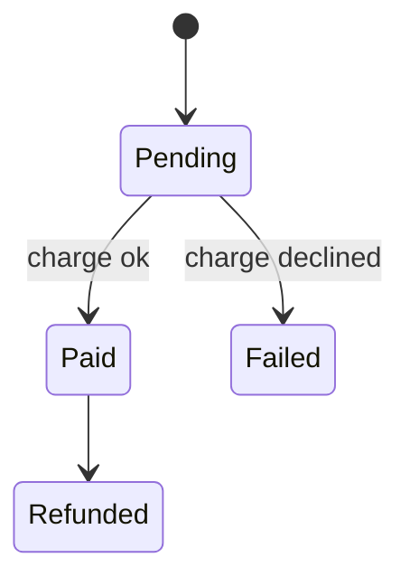

# Blocks

The complete interface of the visualize kit. This file is page source: `selftest` builds `showcase.html` from it, so every example renders exactly as written.

## Shared rules

- A block is a fence: three backticks, the block name, then options (`flag`, `key=value`, `key="two words"`). Inside, one item per line.
- A pipe with spaces around it splits an item into fields. Trailing fields are optional, and text fields take inline Markdown.
- A tone at the end of an item colors it: `{ok}` `{warn}` `{bad}` `{info}` `{accent}` `{muted}`, or `{c1}` to `{c8}` from the chart palette.
- `== Name` starts a group inside a block. `---` splits a block in two. Two spaces of indent nest an item under the one above.
- `title="..."` on a block adds a caption.
- A container is `::: name`, then any source, then `:::`. `== Name` starts each part.
- A fence named for a language (`js`, `python`, `sql`) is highlighted code. `check` reports any other unknown name.
- Nothing needs escaping except a closing script tag, which would end the source: write it `<\/script>`, in prose and in code alike, and it renders without the backslash.
- A fence that holds another fence takes four backticks, so the inner three do not close it.

## Text

Markdown covers headings (`#` is the page title, a `>` right after it is the brief, `##` starts a section), paragraphs, lists, links, tables and images (`` on its own line). Inline extras are written `:name[text]`.

````demo
Plain **bold**, *italic*, `code`, [a link](https://example.com), :kbd[Ctrl+K], :hl[highlight], a :term[hover term|Shown on hover, focus or tap.], badges :ok[passing] :warn[flaky] :bad[failing] :info[beta] :tag[v2.1], a trend :spark[3 5 4 8 12] and math :math[e^{i\pi} + 1 = 0].

> [!tip] Callouts take an optional title
> Kinds: `[!note]` `[!tip]` `[!warn]` `[!danger]` `[!ok]`.

> A quote takes its source on the last line.
> — Grace Hopper

- [x] Task lists
- [~] show
- [ ] status
````

## Numbers

`kpi` is the headline numbers: `label | value | delta | trend values | note`. Delta, trend and note are optional and found by shape. The tone says whether the delta is good.

````demo
```kpi
Requests | 12.4k/s | +8% | 9 10 9.5 11 12.4 {ok}
p99 latency | 212 ms | -12% | 300 280 260 240 212 {ok}
Error rate | 0.4% | +0.1% | 2 2 3 3 4 {bad}
Services | 14 | | | 3 teams
```
````

`bars` ranks sizes; a third field is a note. `max=100` fixes the scale.

````demo
```bars
api-gateway | 420 ms | Rust
checkout | 310 ms {warn}
search | 95 ms
```
````

`meter` is progress against a limit, as a percent or `used / limit`.

````demo
```meter
Disk | 412 / 500 GB {warn}
Test coverage | 86% {ok}
```
````

`parts` is shares of a whole.

````demo
```parts
TypeScript | 48,200
Rust | 21,400
SQL | 6,100
Shell | 1,300
```
````

`funnel` is drop-off between stages; a third field is a note.

````demo
```funnel
Visited | 12,000
Signed up | 3,100
Activated | 1,240
Paid | 310
```
````

`kv` is facts as pairs.

````demo
```kv
Repository | `acme/checkout`
Owner | Payments team
Deploys | 14 a week
```
````

## Tables and charts

A Markdown table renders as written. The `table` block skips the separator row and adds `sort`, `filter` and `bar=Column`. A `*` after a header marks the column that matters, and `✓` `✗` `~` (or `yes` `no` `partial`) become marks. A tone at the end of a row tints the row.

````demo
```table sort filter bar=Latency
Store | Latency | Durable | Ops cost *
Postgres | 4.2 ms | ✓ | Low
Redis | 0.3 ms | ~ | Medium
DynamoDB | 6.8 ms | ✓ | Low
SQLite | 0.9 ms | ✓ | None {ok}
```
````

`heatmap` colors a grid by value. `diverging` centers on zero (or `mid=50`).

````demo
```heatmap
Hour | Mon | Tue | Wed | Thu | Fri
09:00 | 12 | 18 | 15 | 22 | 9
13:00 | 40 | 44 | 38 | 51 | 30
17:00 | 25 | 21 | 28 | 26 | 14
```
````

`chart` draws a header row and number rows as `bar`, `line`, `area`, `scatter`, `pie`, `donut` or `radar`. Each number column is a series. Options: `stacked`, `horizontal`, `log`, `x="axis title"`, `y="axis title"`, `h=24` (height in rem). The data stays readable as a table under the chart.

````demo
```chart line x="Week" y="ms" title="p99 latency fell after the cache landed in week 3."
Week | Before cache | After cache
1 | 310 | 310
2 | 305 | 300
3 | 320 | 190
4 | 315 | 140
```
````

## Lists and cards

`cards`, `steps` and `timeline` share one form: `title | text | meta` per line (timeline is `when | title | text`). For longer bodies, separate items with blank lines; the first line is the title and the rest is any source. `cards cols=3` sets the column count.

````demo
```cards
Gateway | Terminates TLS and routes by path. | Rust · 4 pods {c1}
Checkout | Owns carts, orders and payment intents. | TypeScript · 12 pods {c2}
Ledger | Append-only record of money movement. | Postgres {c3}
```
````

````demo
```steps
Clone and install | `make setup` pulls dependencies and seeds the database.
Run the tests | `make test` takes about 40 seconds.
Open a pull request | CI deploys a preview for every branch.
```
````

````demo
```timeline
2024-03 | First commit | A single Express app.
2025-01 | Split into services | Checkout and ledger move out. {info}
2026-06 | Multi-region | Active-active in two regions. {ok}
```
````

`checklist` shows status with a progress bar: done, in progress, blocked, to do, each with an optional note.

````demo
```checklist
[x] Schema migrated | Tuesday
[~] Backfill running | 62%
[!] Cutover | waiting on security review
[ ] Remove old tables
```
````

`proscons` takes `+` and `-` lines. With `== Option` groups it makes one card per option.

````demo
```proscons
== Monorepo
+ One version of every library
- CI needs path filters
== Polyrepo
+ Teams deploy alone
- Shared changes take many pull requests
```
````

`kanban` is columns of cards with optional meta.

````demo
```kanban
== To do
Rate limiting | API
Audit log export
== Doing {info}
Idempotency keys | Mina {warn}
== Done {ok}
Webhook retries | shipped in 2.3
```
````

## Diagrams

`flow` is a pipeline: `A -> B -> C` on a line, with `Name: detail` in a step. Options: `loop` or `loop="label"` draws the way back, `vertical` stacks it. It stacks by itself on a phone.

````demo
```flow loop="every commit"
Push -> Build: 2 min -> Test: 6 min {warn} -> Deploy {ok}
```
````

`graph` lays out dependencies from edges: `A -> B: label`, `-->` dashed, `<->` both ways, `--` no arrow, chains allowed. A line without an arrow declares a node: `id: Label | detail {tone}`. `LR` runs left to right.

````demo
```graph
web: Web app | Next.js
api: API gateway {accent}
web -> api: HTTPS
api -> auth: verifies token
api -> orders -> db: SQL
orders --> queue: events
queue --> mailer
db: Postgres | primary + 2 replicas {c3}
```
````

`sequence` is messages in order: `A -> B: text`, `-->` for a reply, `note: text`, `== phase`. `nums` numbers the messages; `actors: A, B, C` fixes the column order.

````demo
```sequence nums
Browser -> API: POST /orders
API -> Ledger: reserve funds
Ledger --> API: reserved
note: The order is durable from here on.
API --> Browser: 201 Created
```
````

`erd` is a data model: entities with indented fields, then relations (`1--1`, `1--*`, `*--*`).

````demo
```erd
users
  id uuid PK
  email text
orders
  id uuid PK
  user_id uuid FK
  total_cents int
line_items
  order_id uuid FK
  sku text
users 1--* orders: places
orders 1--* line_items: contains
```
````

`layers` is tiers of a stack, top first; a third field is a note.

````demo
```layers
Clients | Web, iOS, Android
Edge | CDN, API gateway | TLS ends here {accent}
Services | Checkout, Search, Ledger
Data | Postgres, Redis, S3 {c3}
```
````

`tree` is a hierarchy by indent.

````demo
```tree
Platform | 41 engineers
  Payments
    Checkout {accent}
    Ledger
  Growth
    Search
```
````

`sankey` is quantities flowing between stages.

````demo
```sankey
Organic -> Signup: 620
Ads -> Signup: 380
Signup -> Trial: 700
Signup -> Bounced: 300
Trial -> Paid: 240
Trial -> Churned: 460
```
````

`treemap` is nested sizes; children indent under a group.

````demo
```treemap
src
  checkout | 18400
  ledger | 9200
  search | 6100
tests | 7300
docs | 2100
```
````

`gantt` is spans on a time axis: `task | start | end`. Times are dates (`2026-03-01`, `2026-03`, `2026-Q1`) or plain numbers, the end may be relative (`+2w`, `+10d`), and a task with no end is a milestone. `== Group` adds a heading, `today=2026-04-10` a marker, and `unit=ms` labels a number axis, which makes a trace waterfall.

````demo
```gantt today=2026-04-10
== Migration
Dual writes | 2026-03-02 | 2026-03-27 {ok}
Backfill | 2026-03-23 | +4w {info}
Cutover | 2026-04-24
== Cleanup
Drop old tables | 2026-05-04 | +2w {muted}
```
````

`quadrant` places items on two axes scored 0 to 10: `label | x | y`. Options: `x="low -> high"`, `y="low -> high"`, `q="top left, top right, bottom left, bottom right"`.

````demo
```quadrant x="Low effort -> High effort" y="Low impact -> High impact" q="Quick wins, Big bets, Fill-ins, Money pits"
Cache headers | 2 | 8 {ok}
Rewrite in Rust | 9 | 7
Rename flags | 2 | 2 {muted}
```
````

`risk` is a 5×5 matrix: likelihood and impact from 1 to 5, then an optional note.

````demo
```risk
Backfill overruns the window | 4 | 3 | Rehearse on a copy
Double charge during cutover | 2 | 5 | Idempotency keys
Dashboard lag | 3 | 1
```
````

`cells` is a binary or memory layout: `field | size | note`. `per=32` wraps rows at 32 units, `unit=bits` names the unit.

````demo
```cells per=32 unit=bits
Version | 4
IHL | 4
DSCP | 6
ECN | 2
Total length | 16 | Header plus data, in bytes
```
````

`mermaid` takes Mermaid source for anything else drawn: state, class, mindmap.

````demo

````

## Code

A language fence is highlighted code. Options: `title="path"`, `hl=2,5-7` highlights lines, `nums` numbers them, and `notes` reads everything after a `---` line as `lines: note`.

````demo
```ts title="src/retry.ts" notes
export async function retry<T>(fn: () => Promise<T>, tries = 3): Promise<T> {
  for (let i = 0; ; i++) {
    try { return await fn(); }
    catch (err) { if (i >= tries - 1) throw err; }
    await sleep(2 ** i * 100);
  }
}
---
4: The last failure is rethrown, so callers see the real error.
5: Backoff doubles: 100, 200, 400 ms.
```
````

`diff` colors a unified diff and counts the lines.

````demo
```diff title="src/config.ts"
@@ -12,3 +12,4 @@
 export const config = {
-  timeout: 5000,
+  timeout: 2000,
+  retries: 3,
 };
```
````

`terminal` shows a session: `$ command` lines, then output. `replay` adds a button that types it out.

````demo
```terminal replay title="deploy"
$ make deploy ENV=staging
Building image...
✓ pushed registry/checkout:4f2a9c1
$ kubectl rollout status deploy/checkout
deployment "checkout" successfully rolled out
```
````

`log` colors log lines by level and adds level filters.

````demo
```log
2026-04-10T09:14:02Z INFO  order 8841 created
2026-04-10T09:14:03Z WARN  ledger slow: 812 ms
2026-04-10T09:14:05Z ERROR charge failed: card_declined
```
````

`json` is a collapsible viewer for valid JSON (`open=1` sets how many levels start open). Text that is not valid JSON falls back to highlighted code.

````demo
```json
{"id": "ord_8841", "status": "failed", "total_cents": 4200, "items": [{"sku": "TSHIRT-M", "qty": 2}], "customer": null}
```
````

`filetree` takes indented names or one path per line. After a name: `+12 -3` for diff stats, `(new)` `(deleted)` `(renamed)` for status, `# note` for a comment. It also reads `git diff --stat` and `git diff --numstat` output as is. `depth=1` starts deeper folders closed.

````demo
```filetree
src/checkout/cart.ts +48 -12
src/checkout/intent.ts +120 (new) # payment intents live here
src/ledger/post.ts +6 -31
migrations/0042_intents.sql +22 (new)
README.md +3 -1
```
````

`api` documents endpoints. Each starts `METHOD /path | summary`, then `key: value` facts, parameter rows `name | in | type | required | description`, response rows `200 | description`, and an example after `---`.

````demo
```api
POST /orders | Create an order
Auth: Bearer token
items | body | array | required | SKUs and quantities
coupon | body | string | optional | One code per order
201 | The order, with `status: pending`
402 | Card declined
---
{"id": "ord_8841", "status": "pending"}
GET /orders/{id} | Fetch one order
200 | The order
404 | No such order
```
````

`commits` draws history, newest first. Write `main < feature` as the branch of a merge commit.

````demo
```commits
9c1d4e2 | Merge payment intents | main < intents | Mina, 2 days ago
4f2a9c1 | Handle declined cards | intents | Sam
b7e0a13 | Add intents table | intents | Sam
77aa0f9 | Bump Postgres to 17 | main | Ravi
```
````

## Layout and interaction

`tabs` shows one part at a time; keep it to four or fewer so a phone shows every tab.

````demo
::: tabs
== npm
```sh
npm install @acme/checkout
```
== pnpm
```sh
pnpm add @acme/checkout
```
:::
````

`cols` puts parts side by side (`::: cols 3` fixes the count) and stacks them on a phone. A tone on a part marks it, which makes a before and after.

````demo
::: cols
== Before {bad}
One process handled web, jobs and cron. A slow job stalled checkout.
== After {ok}
Jobs run in their own pool. Checkout p99 dropped from 900 ms to 210 ms.
:::
````

`details` folds a side detail away: `::: details Title`, with `open` to start open.

````demo
::: details Why not a queue per tenant?
At 4,000 tenants the broker spends more time on metadata than on messages.
:::
````

`stepper` walks through parts one at a time, each holding any source.

````demo
::: stepper
== A client sends a write
The leader appends it to its log.
== The leader replicates
```flow
Leader -> Follower A {ok} -> Follower B {ok}
```
== The entry commits
A majority has it, so the leader applies it and answers.
:::
````

`window` frames content as a screen: `::: window Title`, or `url=...` for a browser bar.

````demo
::: window url=https://app.example.com/orders/8841
**Order 8841** :bad[failed]

Card declined. The customer was emailed a retry link.
:::
````

`quiz` checks understanding; the text after the pipe explains each answer.

````demo
```quiz
? A follower stops hearing from the leader. What happens first?
- The cluster stops taking writes | Only until a new leader wins.
+ The follower starts an election | Its election timeout fires and it asks for votes.
```
````

`calc` lets the reader move inputs. Inputs are `name = start | Label | min..max step n | unit`; after `---` comes any source with `{expression}` or `{expression | decimals}` in it.

````demo
```calc
rps = 200 | Requests per second | 10..2000 step 10
kb = 4 | Payload | 1..64 | KB
---
That is **{rps * kb / 1024 | 1} MB/s**, or about **{rps * kb * 86400 / 1048576 | 0} GB** a day.
```
````

`gallery` is a grid of images that open larger.

````demo
```gallery
 Before
 After
```
````

`math` is display TeX; `:math[...]` is the inline form.

````demo
```math
\text{availability} = \frac{\text{MTBF}}{\text{MTBF} + \text{MTTR}}
```
````

`raw` is HTML for what no block covers. Build it from kit parts so it matches: `.card`, `.plate`, `.node`, `.badge`, `.chips`, and tokens for color. A script that needs the rendered page goes after `kit.js` and waits for the `kit:ready` event; `kit.color('accent')` hands a token to canvas code and `kit:theme` fires when the theme changes.

````demo
```raw
<div class="plate" style="display: flex; gap: 1rem; align-items: center; justify-content: center">
  <div class="node" data-tone="accent"><b>Custom</b><small>kit classes</small></div>
  <span class="badge" data-tone="ok">and tokens</span>
</div>
```
````
